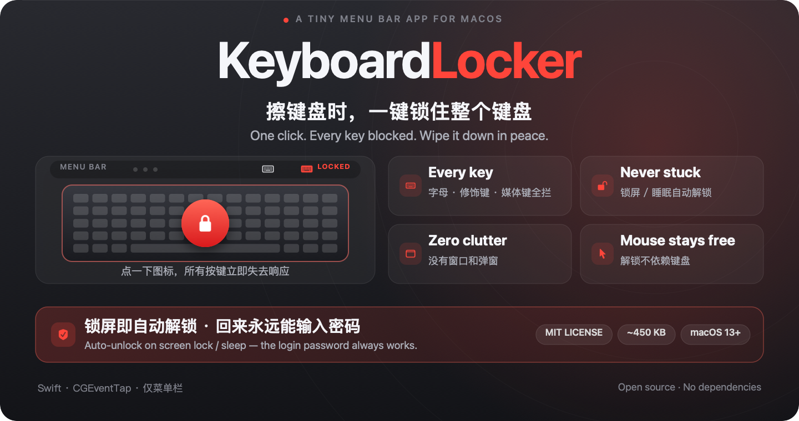
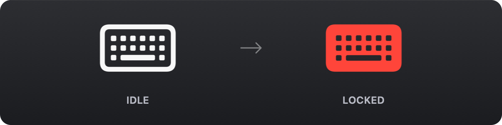

# KeyboardLocker



A menu bar app for macOS that locks every key on your keyboard with a single click — for when you need to wipe it down.

[中文说明](README.zh-CN.md)

## Why

Cleaning a keyboard always ends up opening a dozen windows, triggering shortcuts, and typing half a sentence into whatever editor happens to be focused. Locking the whole keyboard is far less stressful than tiptoeing around it.

## Features

- **One click to lock** — click the menu bar icon to toggle
- **Every key captured** — letters, modifiers, function keys, and media keys such as volume and brightness
- **State you can see at a glance** — an outlined white keyboard when idle, a solid red one while locked



Right-clicking the icon gives you just two items: lock / unlock, and quit. No windows, no Dock icon, no popups.

## Requirements

- macOS 13 or later
- Xcode Command Line Tools

## Build

```bash
./build.sh              # → build/KeyboardLocker.app
./build.sh --run        # build and launch
./build.sh --install    # build, copy to /Applications, launch
```

## Permissions

Intercepting keyboard events requires system authorization. On first launch the app shows a guided window:

1. Enable KeyboardLocker under System Settings › Privacy & Security › Accessibility
2. If it isn't listed there, enable it under Input Monitoring as well
3. Return to the app and click "Recheck"

> The build script uses an ad-hoc signature by default. **Every rebuild makes macOS treat the app as a new program, so the permission has to be granted again.**
>
> If you iterate on the code often, create a code signing certificate in Keychain Access first (any name, e.g. `KeyboardLocker Dev`) — the build script picks it up automatically and permissions survive rebuilds.

## Usage

| Action | Result |
| --- | --- |
| Left-click the icon | Lock / unlock |
| Right-click the icon | Menu (lock, quit) |
| Hover | Shows current state |

The mouse and trackpad stay fully usable while locked, so unlocking never depends on the keyboard.

## Safety

A keyboard lock that can't be undone is the worst possible failure mode, so there are several layers:

- **Process exit restores the keyboard** — the event tap dies with the process
- **Screen lock and sleep auto-unlock** — locking the screen, display sleep, or system sleep releases the keyboard immediately, so the login password can always be typed
- **Double detection** — a system notification plus a once-per-second session check; worst case it unlocks within a second
- **Refuses to lock while the screen is already locked**
- **Quit is always reachable** — the menu item is unaffected by the lock

## Limitations

- The power button, Touch ID, and the trackpad are out of scope — that's a system-level boundary
- While a password field is focused, macOS's Secure Input cuts off event taps, so keys can slip through during that window
- Some vendor-specific keys on third-party keyboards may bypass the event layer

## Self-test

```bash
./build/KeyboardLocker.app/Contents/MacOS/KeyboardLocker --selftest
```

Creates the interceptor, injects 20 synthetic key events, and counts how many were swallowed. Prints `PASS` on success (exit code 0).

## Releasing

Requires a clean working tree on `main`, synced with `origin`, and `gh auth login` done.

Write the version section in `CHANGELOG.md` first (otherwise `git log` is used to fill the notes):

```markdown
## 1.0.1 — 2026-11-04

- What changed
```

Then preview and publish:

```bash
./release.sh 1.0.1 --dry-run   # preview notes and actions, nothing is written or pushed
./release.sh 1.0.1             # bump version, build, tag, push, create the Release
./release.sh patch             # or: minor / major, computed from the latest tag
```

The script bumps `CFBundleShortVersionString` / `CFBundleVersion` in a commit, rebuilds with an ad-hoc signature, packages `KeyboardLocker.zip` plus a `.sha256`, creates an annotated tag, pushes both, and publishes the GitHub Release using the changelog section as its notes (followed by the standard install instructions).

| Flag | Purpose |
| --- | --- |
| `--dry-run` | Build and preview only; no commits, tags, or pushes |
| `--notes-file FILE` | Use a complete custom Release description |
| `--draft` | Create the Release as a draft |
| `-y` | Skip the confirmation prompt |

## How it works

- `KeyboardLockEngine` installs a persistent `CGEventTap` at the `.cghidEventTap` layer — below system shortcut handling, so ⌘Tab and ⌘Q get swallowed too. The tap runs on its own thread's run loop, so a busy main thread can't miss keystrokes.
- Locking flips a mutex-protected flag rather than creating or destroying the tap: no latency, no failure path.
- When macOS disables the tap after a callback timeout, the callback re-enables it immediately so the keyboard never quietly comes back to life.
- The menu bar icon is a template mask tinted through CoreGraphics. The red state is baked into a bitmap before it reaches the button — a palette-tinted SF Symbol gets re-rendered by the menu bar as a template and turns white. Both states share one canvas size, otherwise `NSStatusItem` miscalculates the button width on the second toggle and the icon vanishes.
- **Modifier release on unlock**: a ⌘/⇧/⌥/⌃ held at the moment of locking has its key-up swallowed, leaving the system convinced it's still down. On unlock the app broadcasts empty flags and sends a key-up for each modifier. Caps Lock is excluded because it's a toggle, not a held key.

## Project layout

```
Sources/
  main.swift                     Entry point
  AppDelegate.swift              Menu bar, menu, system events
  KeyboardLockEngine.swift       CGEventTap interception
  StatusIcon.swift               Menu bar icon states and drawing
  PermissionWindow.swift         Permission onboarding window
  SelfTest.swift                 Command-line self-test
Resources/Info.plist             App metadata
Tools/make-icon.swift            App icon generator
Tools/make-promo.swift           README promo banner generator
Tools/make-readme-figure.swift   README state diagram generator
build.sh                         Build script
release.sh                       Version bump, packaging and GitHub Release
```

## License

[MIT](LICENSE)
