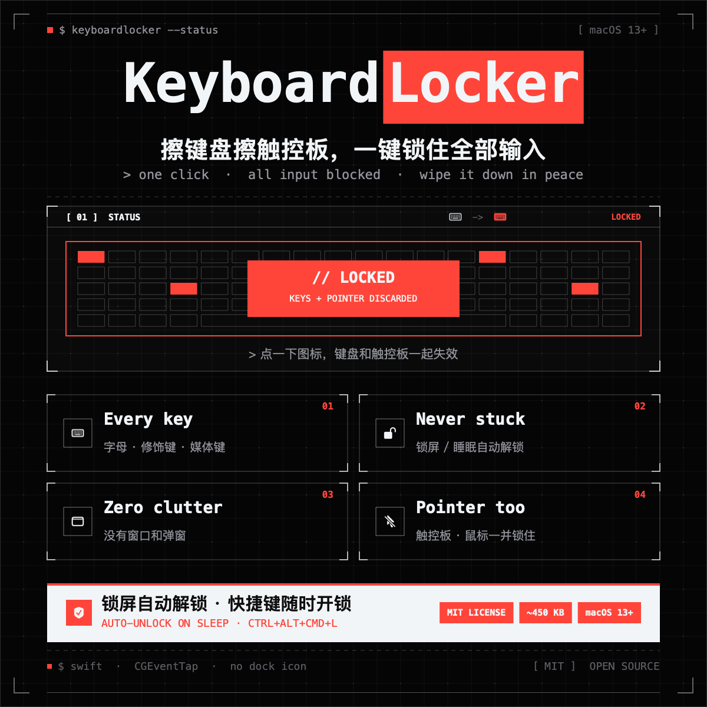
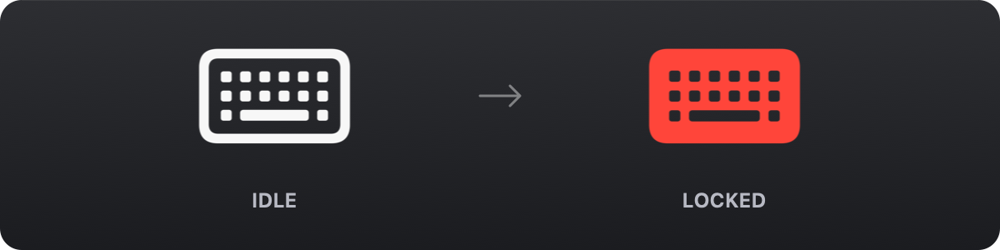
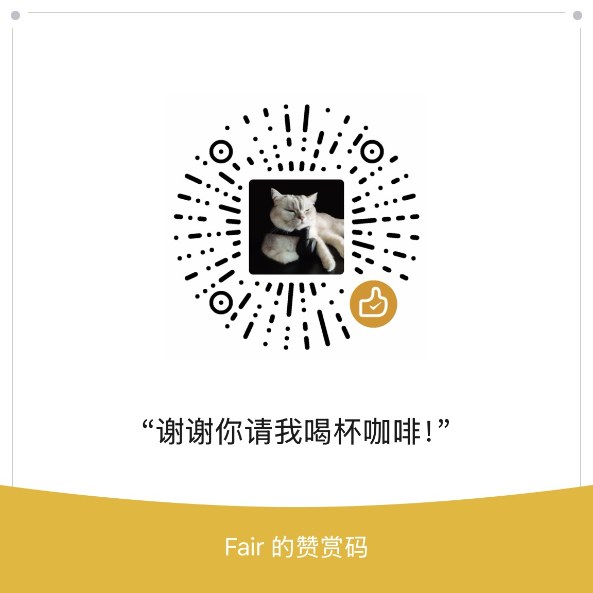

# KeyboardLocker



清洁键盘和触控板时点一下菜单栏图标，键盘和指针一起失效；按 ⌃⌥⌘L 立刻恢复。
只有一个菜单栏图标，没有窗口、没有 Dock 图标、不会弹任何提示。

[English](README.md)

## 为什么需要它

擦键盘时总会压到按键——打开一堆窗口、触发快捷键、把半句话打进编辑器。
擦触控板时也一样：光标乱飞、误点、误滚。把输入整体锁住比小心擦拭省事得多。

## 功能

- **点一下就锁**：点击菜单栏图标在锁定 / 解锁之间切换
- **拦下全部按键**：字母数字、修饰键、功能键、音量 / 亮度等媒体键
- **触控板一并锁住**：移动、点击、滚动、拖拽、手势全部丢弃，光标钉在原地
- **连注入的输入也拦**：HID 与 session 两层各挂一个 tap，Sidecar、通用控制、触摸屏驱动注入的指针事件同样吞掉
- **一眼看出状态**：平时是线框白色键盘，锁定时变成实心红色键盘



右键图标只有两项：锁定 / 解锁、退出；菜单里写着快捷键 ⌃⌥⌘L，忘了也不至于锁死。

## 环境要求

- macOS 13 或更高版本
- Xcode 命令行工具

## 构建

```bash
./build.sh              # 构建到 build/KeyboardLocker.app
./build.sh --run        # 构建后直接启动
./build.sh --install    # 构建后安装到 /Applications 并启动
```

## 权限

拦截键盘事件需要系统授权，首次启动会弹出引导窗口：

1. 在「系统设置 › 隐私与安全性 › 辅助功能」中打开 KeyboardLocker
2. 若列表中没有它，到「输入监控」里同样打开
3. 回到应用点击「重新检测」

> 构建脚本默认使用 ad-hoc 签名。**每次重新编译后系统会把应用视为新程序，需要重新勾选权限。**
>
> 如果频繁改代码，可以先在「钥匙串访问」里创建一个代码签名证书（名称随意，
> 例如 `KeyboardLocker Dev`），构建脚本会自动检测并使用它——
> 这样权限在重新编译后依然有效。

## 使用

| 操作 | 结果 |
| --- | --- |
| 左键点击图标 | 锁定（键盘 + 触控板） |
| 右键点击图标 | 打开菜单（锁定、退出） |
| ⌃⌥⌘L | 锁定 / 解锁 |

同一个快捷键来回切换：未锁定时按下即上锁，锁定后再按即解锁。
锁定期间指针事件全部丢弃（连菜单栏图标也点不动），所以只能靠键盘。
它取的是物理 L 键位，换键盘布局也照样有效；修饰键严格匹配，多按一个 ⇧ 就不会触发。

## 安全设计

输入被锁住却解不开是这类工具最糟糕的故障，所以留了几层兜底：

- **纯键盘开关**：⌃⌥⌘L 一键锁、再按一键解，不需要鼠标
- **进程结束即恢复**：event tap 跟随进程生命周期，应用退出或崩溃后输入立刻恢复正常
- **锁屏 / 睡眠自动解锁**：屏幕锁定、显示器睡眠、系统休眠时立即解锁，保证回来能输入登录密码
- **锁屏检测双保险**：除了系统锁屏通知，锁定期间每秒还会查一次会话状态做兜底，最坏 1 秒内一定解锁
- **屏幕已锁时拒绝上锁**：此时用户唯一需要的就是键盘能打密码
- **合盖即可脱困**：即使键盘突然没电，合上盖子进入睡眠也会解锁
- **锁定后别忘了快捷键**：右键菜单里写着它，锁定前顺手看一眼

## 已知限制

- **电源键、Touch ID**不在拦截范围内，这是系统层面的设计
- 锁定期间菜单栏图标不可点击——指针失效的必然结果，只能按 ⌃⌥⌘L 解锁
- 调度中心、启动台这类由 macOS 自己识别的手势可能仍会触发
- **触控条（Touch Bar）拦不到**：它的按键不走 CGEvent，而是走 NSTouchBar 的私有通道
- 外接触摸屏、数位屏的触摸走 HID，能拦住；但它们自己的驱动面板（如 Wacom 设置）不受影响
- 密码框处于活跃状态时，macOS 的「安全输入」会切断 event tap，这期间按键会漏过去
- 少数第三方键盘的厂商自定义键走私有通道，可能绕过事件层

## 自检

想确认拦截是否真的生效：

```bash
./build/KeyboardLocker.app/Contents/MacOS/KeyboardLocker --selftest
```

它会创建拦截器、注入 20 个模拟按键和一次指针移动，再验证 ⌃⌥⌘L 在锁定状态下能解锁、
在未锁定状态下会被捕获，输出 `PASS` 表示全部通过（退出码 0）。

## 发布新版本

前置条件：工作区干净、位于 `main` 且与远程同步、已执行 `gh auth login`。

建议先在 `CHANGELOG.md` 里写好对应版本的段落（不写的话脚本会用 `git log` 自动生成条目）：

```markdown
## 1.0.1 — 2026-11-04

- 这次改了什么
```

然后预览、发布：

```bash
./release.sh 1.0.1 --dry-run   # 只预览说明和动作，不改文件、不推送
./release.sh 1.0.1             # 改版本号 → 构建 → 打 tag → 推送 → 创建 Release
./release.sh patch             # 也可以写 minor / major，基于最新 tag 自动递增
```

脚本会依次：把 `CFBundleShortVersionString` / `CFBundleVersion` 写进 `Info.plist` 并提交、以 ad-hoc 签名重新构建、
打包 `KeyboardLocker.zip` 和 `.sha256`、创建附注 tag、推送分支与 tag、
最后用 CHANGELOG 对应段落（附加固定的安装说明）创建 GitHub Release。

| 参数 | 作用 |
| --- | --- |
| `--dry-run` | 只构建并预览，不提交、不打 tag、不推送 |
| `--notes-file FILE` | 用自己写好的完整 Release 说明 |
| `--draft` | 创建为草稿，不对外发布 |
| `-y` | 跳过确认提示 |

## 实现要点

- `KeyboardLockEngine` — 用 `CGEvent.tapCreate` 在 `.cghidEventTap` 层建立常驻事件拦截，
  位于系统快捷键处理之前，因此 ⌘Tab、⌘Q 之类同样会被吞掉。
  tap 挂在独立线程的 runloop 上，主线程卡顿不影响拦截。
- **两层 tap**：`.cghidEventTap` 管实体设备（键盘、触控板、触摸屏），`.cgSessionEventTap` 管
  Sidecar、通用控制、远程控制这类从 session 层注入的事件——只挂 HID 层时后者能直接漏过去（已实测）。
- **键盘和指针一起拦**：掩码里同时包含按键、鼠标按键、移动、拖拽、滚轮、数位板指针/靠近，
  以及 NX 29…34 的手势与触摸事件，锁定期间一律 `return nil`，应用层什么都收不到。
- **光标钉在原地**：事件被丢弃后光标位置仍会被窗口服务器提前改掉，所以每个带位移的移动事件
  都用 `CGWarpMouseCursorPosition` 掰回锁定点。Warp 自身产生的事件位移为 0，据此区分，
  否则「Warp → 新事件 → 又 Warp」会变成每秒两百次的空转。
  不用 `CGAssociateMouseAndMouseCursorPosition(0)`：那是窗口服务器的全局状态，进程异常退出会把光标留在冻住的状态。
- **快捷键在吞事件之前判定**：修饰键状态由 `flagsChanged` 自己记一份（锁定期间它同样被吞），
  `keyDown` 命中 ⌃⌥⌘ + L 时两种状态都能识别，先执行切换再吞掉这个按键，字母不会打进当前应用。
- 锁定 / 解锁只翻转一个带锁的标志位，不创建、不销毁 tap，切换没有延迟也不会失败。
- **不改任何系统手势设置**：不写 `com.apple.AppleMultitouchTrackpad`，也不动「忽略内置触控板」这类偏好；
  全部在事件层完成，退出应用即恢复，不会留下被改过的系统设置。
- 系统在回调超时时会临时禁用 tap，回调里会立即重新启用，避免键盘「悄悄解锁」。
- 菜单栏图标用 template 蒙版 + CoreGraphics 染色，锁定时把键盘符号烧成红色位图再交给按钮
  （直接给带 palette 的 SF Symbol，菜单栏会按 template 规则重渲染，红色会退回白色）。
  两种状态共用同一画布尺寸，否则 `NSStatusItem` 在二次切换时会把按钮宽度算错、图标消失。
- **解锁时补发修饰键松开**：锁定那一刻按住的 ⌘ / ⇧ / ⌥ / ⌃，其 keyUp 会被吞掉，
  系统会一直以为它被按住。解锁后主动广播一次空 flags 并逐个补 keyUp，让状态归位。
  Caps Lock 是开关而非按住，不参与归零。

## 项目结构

```
Sources/
  main.swift                     入口
  AppDelegate.swift              菜单栏、菜单、系统事件
  KeyboardLockEngine.swift       CGEventTap 拦截引擎
  StatusIcon.swift               菜单栏图标的状态与绘制
  PermissionWindow.swift         权限引导窗口
  SelfTest.swift                 命令行自检
Resources/Info.plist             应用元信息
Tools/make-icon.swift            应用图标生成
Tools/make-promo.swift           README 宣传图生成
Tools/make-readme-figure.swift   README 状态图生成
build.sh                         构建脚本
release.sh                       版本号更新、打包与 GitHub 发布
```

## 赞赏

如果这个工具帮你省下了一次擦键盘时的手忙脚乱，可以扫下面的微信赞赏码请我喝杯咖啡。

<a href="docs/tip.jpg"></a>

谢谢支持！

## 许可证

[MIT](LICENSE)
